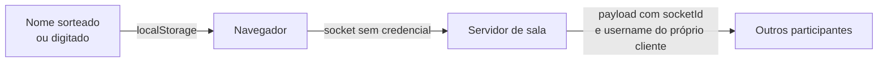
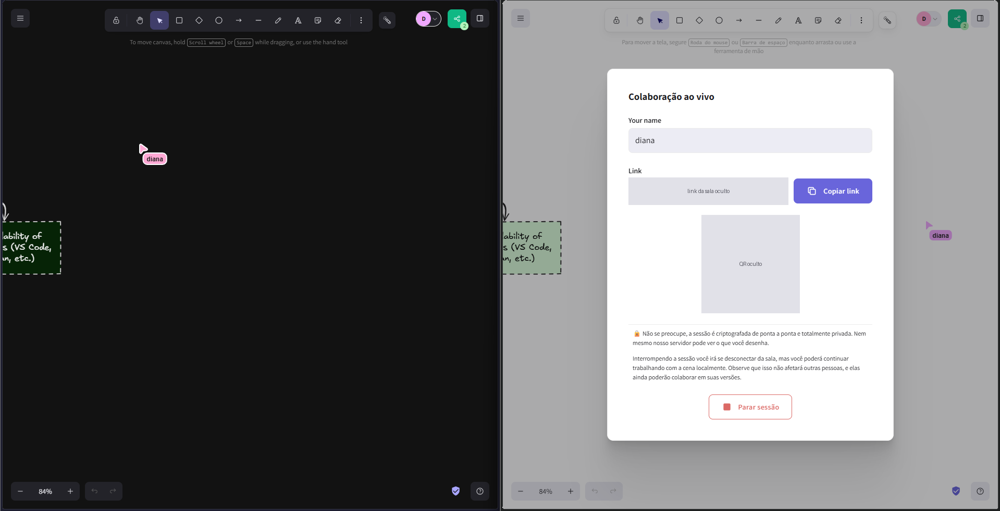

# S-M9 · Suficiência da autenticação

**Nota 1**: o participante só informa um nome em campo livre, ou recebe um nome
sorteado. Nenhuma conta, senha ou token é verificado no app gratuito.



| Mecanismo | Existe no app gratuito? |
| --- | :---: |
| Nome autodeclarado (aleatório ou digitado) | Sim |
| Login (conta e senha, OAuth, Firebase Auth) | Não |
| Credencial enviada ao servidor de sala | Não |
| MFA | Não |

O único "sign in" da interface é do Excalidraw+, que ficou fora do recorte.

## Evidências

=== "Campo de nome"

    O diálogo de colaboração só pede um nome em texto livre. O link da sala e o
    QR code foram cobertos.

    

=== "Busca por autenticação"

    Buscas por login, senha, token e MFA em `excalidraw-app` e `packages/excalidraw`:

    ```text
    firebase/auth, getAuth(, signInWith, onAuthStateChanged, webauthn, totp,
    mfa/2fa/otp, Authorization, auth:  -> nenhuma ocorrência
    password -> só packages/excalidraw/css/styles.scss:817 (comentário de CSS)
    excplus-auth -> só app_constants.ts:56-59 e usos de isExcalidrawPlusSignedUser na interface
    ```

=== "Conexão sem credencial"

    O socket conecta só com a URL do servidor (`Collab.tsx:544-550`):

    ```ts
    this.portal.socket = this.portal.open(
      socketIOClient(import.meta.env.VITE_APP_WS_SERVER_URL, {
        transports: ["websocket", "polling"],
      }),
      roomId,
      roomKey,
    );
    ```

=== "Nome aceito sem validação"

    O nome digitado vai direto para o estado e o localStorage (`Collab.tsx:1037-1039`):

    ```ts
    setUsername = (username: string) => {
      this.setState({ username });
      saveUsernameToLocalStorage(username);
    ```

Registro completo:
[`evidencias/seguranca/S-M9`](https://github.com/FCTE-Qualidade-de-Software-1/2026-2_T02_ADA_LOVELACE/tree/main/evidencias/seguranca/S-M9).
