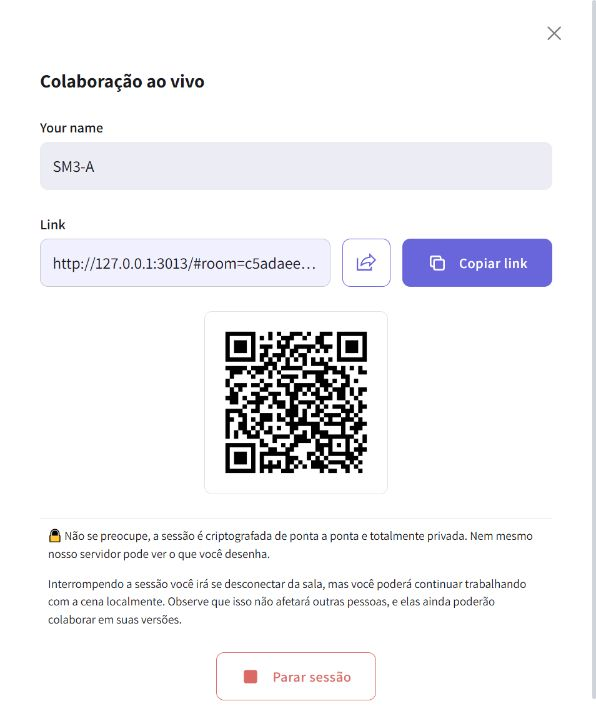
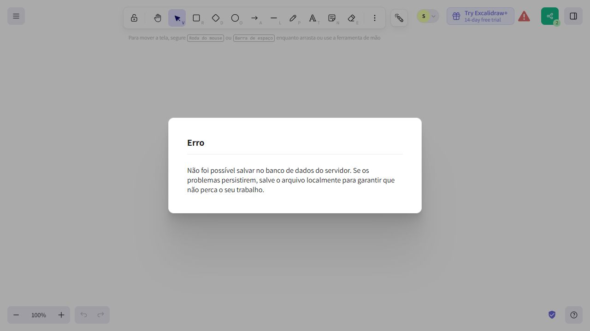

# Evidência S-M3 — Mecanismos de controle de acesso

## 1. Identificação

| Campo | Valor |
| --- | --- |
| Métrica | S-M3 — Mecanismos de controle de acesso |
| Objetivo | O1 — Proteção das informações e controle de acesso |
| Questão (S-Q) | S-Q2 — É possível controlar quem acessa um desenho compartilhado? Confidencialidade |
| Tarefa do plano | [Issue #56](https://github.com/FCTE-Qualidade-de-Software-1/2026-2_T02_ADA_LOVELACE/issues/56); definição na Tabela 6 do [roteiro GQM](../../../docs/analise/roteiro.md) |
| Responsável | Renato Araújo Gameiro (`renatoyx`), coleta assistida por agente |
| Data(s) da coleta | 2026-11-12; preparação a partir de 11:46, observação da interface entre 11:53 e 11:56, UTC−03:00 |
| Revisado por | Pendente de revisão por outro integrante |
| Versão | Excalidraw [`e7b534668a60add7f725531f3c9abf32508c7b4e`](https://github.com/excalidraw/excalidraw/commit/e7b534668a60add7f725531f3c9abf32508c7b4e) |
| Ambiente | Windows 10 Home 22H2, build 19045.6466; PowerShell; Node.js 22.23.3; Corepack 0.36.0; Yarn 1.22.22; Vite 5.0.12; navegador integrado do Codex (IAB), interface em português brasileiro |
| Serviços locais | Cliente em `http://127.0.0.1:3013/`; servidor oficial `excalidraw-room`, commit `03ff435860b508d7cd9e005cfc90f7977ae2a593`, em `http://localhost:3014` |

## 2. O que foi medido

Existência de controles oferecidos ao usuário para proteger por senha, configurar expiração ou revogar um link de desenho compartilhado, um ponto por mecanismo. Foram examinados os fluxos do cliente gratuito de colaboração (`#room`) e de exportação de cena (`#json`), por observação da interface e leitura dos componentes e funções que implementam esses fluxos.

A medição conta mecanismos disponíveis no cliente, não propriedades presumidas da infraestrutura. A validade do link após a saída do criador foi testada na colaboração local com outro participante presente. A criação efetiva de um link `#json` e a persistência da sala no Firebase não puderam ser verificadas neste ambiente; isso não foi convertido em evidência de ausência de controles em servidores externos.

## 3. Procedimento

1. Executar `git fetch origin`, conferir estado, branches, autoria Git e `origin/main`. O repositório estava limpo, em `main`, no commit `da62b70ff0237079ab774dd1ab3e0e16edd77fe0`, igual a `origin/main` após o fetch. Criar `feat/seguranca-sm3-controle-acesso` a partir de `origin/main`. A identidade configurada, Renato Araújo Gameiro / `renatogameiro1@gmail.com`, coincide com os commits anteriores de Renato; nenhuma identidade foi alterada nem se realizou nova verificação de e-mail no GitHub.
2. Ler a issue #56 e consultar seus comentários (nenhum), o roteiro GQM, o template e os registros S-M1, S-M2, S-M11 e S-M12 como referências metodológicas. Nenhum print ou teste anterior foi apresentado como coleta nova.
3. Consultar os PRs abertos e seus arquivos: [#89](https://github.com/FCTE-Qualidade-de-Software-1/2026-2_T02_ADA_LOVELACE/pull/89) modifica `mkdocs.yml` e adiciona o plano de avaliação; [#90](https://github.com/FCTE-Qualidade-de-Software-1/2026-2_T02_ADA_LOVELACE/pull/90), [#88](https://github.com/FCTE-Qualidade-de-Software-1/2026-2_T02_ADA_LOVELACE/pull/88) e [#87](https://github.com/FCTE-Qualidade-de-Software-1/2026-2_T02_ADA_LOVELACE/pull/87) adicionam medições e alteram planos de tarefas das outras características. Nenhum desses quatro PRs altera `docs/resultados/index.md` no momento da consulta. Esta entrega modifica somente a pasta desta métrica.
4. Localizar o checkout oficial usado na S-M11, confirmar o SHA completo e o estado limpo. Como não havia dependências instaladas, clonar esse checkout para uma pasta temporária e executar o mesmo SHA em detached HEAD. Não usar o HEAD do repositório da disciplina como se fosse o SHA do Excalidraw. Instalar dependências pelo lockfile original, com scripts de instalação desabilitados.
5. Preparar o servidor oficial de colaboração na revisão já documentada pelo grupo. Na cópia temporária do cliente, sobrescrever apenas configuração local ignorada pelo Git: socket local, backends de cena e IA locais, Firebase vazio, tracking e Sentry desabilitados. Nenhum arquivo de código rastreado do cliente foi modificado.
6. No navegador, abrir `http://127.0.0.1:3013/` (aba A), clicar em **Colaboração ao vivo...** e examinar o diálogo de criação (E1). Clicar em **Iniciar sessão**. Examinar nome, link, copiar, compartilhamento nativo, QR code e **Parar sessão** (E2). Não há campo de senha, prazo ou comando para invalidar o link nesses diálogos.
7. Identificar A como `SM3-A`. Fechar o erro de salvamento do Firebase, que não está configurado. Abrir a mesma URL de sala em outra aba (B), dispensar o aviso de persistência com Escape e desenhar um retângulo com a ferramenta **Retângulo** (E3). A interface mostra dois participantes.
8. Em A, clicar em **Parar sessão** e aceitar a confirmação de substituição da cena local de teste. A URL de A volta a `http://127.0.0.1:3013/`. Manter B conectado. Abrir uma terceira aba (C) com **exatamente o link original**, sem criar outra sala: C entra, recebe o retângulo e a interface volta a mostrar dois participantes (B e C), conforme E4/E8. Não foi solicitada senha. Logo, essa ação não revogou o link para novos acessos nesse caso.
9. Em uma quarta aba local (D), abrir **menu > Salvar como...**. Examinar **Link compartilhável**, descrito como “Exportar como link de somente leitura” (E5). Não são oferecidos controles de senha, expiração ou revogação. Clicar em **Exportar link**: a interface informa “Não foi possível criar um link de compartilhamento” (E7), pois o backend configurado em `localhost:9999` não está disponível. Não foi gerado nem reaberto um link de cena nesta coleta.
10. Ler os componentes completos de compartilhamento e seguir os callbacks até a geração dos links, envio, importação, encerramento, persistência e desconexão (C1–C15). Usar buscas apenas como apoio. Registrar os trechos numerados e as buscas em E9.

### 3.1 Comandos executados

Preparação do repositório da disciplina:

```powershell
git fetch origin
git status --short --branch
git branch -vv
git config user.name
git config user.email
git worktree list
git rev-parse origin/main
git switch -c feat/seguranca-sm3-controle-acesso origin/main
git log -5 --author='Renato' --format='%h %an <%ae>'
```

Preparação do checkout temporário, em 12/11/2026:

```powershell
$sm3Source='C:/Users/Renato/Documents/Codex/2026-11-08/files-pasted-by-the-user-implementa/work/excalidraw-e7b5346'
$sm3Run=Join-Path $env:TEMP 'sm3-e7b5346-20261112'
git -c safe.directory=$sm3Source -C $sm3Source rev-parse HEAD
git -c safe.directory=$sm3Source -C $sm3Source status --short
git -c safe.directory=$sm3Source -c safe.directory="$sm3Source/.git" clone --no-hardlinks --no-checkout $sm3Source $sm3Run
git -C $sm3Run checkout --detach e7b534668a60add7f725531f3c9abf32508c7b4e
```

Na raiz da cópia temporária, instalar e criar `.env.development.local` com o conteúdo listado abaixo. O cache do Corepack foi reutilizado do ambiente anterior:

```powershell
$env:COREPACK_HOME='C:/Users/Renato/Documents/Codex/2026-11-08/files-pasted-by-the-user-implementa/work/corepack-cache'
$env:COREPACK_DEFAULT_TO_LATEST='0'
corepack.cmd yarn install --frozen-lockfile --ignore-scripts --non-interactive
```

```dotenv
VITE_APP_PORT=3013
VITE_APP_WS_SERVER_URL=http://localhost:3014
VITE_APP_BACKEND_V2_GET_URL=http://localhost:9999/
VITE_APP_BACKEND_V2_POST_URL=http://localhost:9999/post/
VITE_APP_AI_BACKEND=http://localhost:3016
VITE_APP_FIREBASE_CONFIG={}
VITE_APP_ENABLE_TRACKING=false
VITE_APP_ENABLE_ESLINT=false
VITE_APP_DISABLE_SENTRY=true
VITE_APP_DISABLE_PREVENT_UNLOAD=true
```

Servidor de colaboração, em terminal próprio na pasta clonada:

```powershell
git clone https://github.com/excalidraw/excalidraw-room.git C:/Users/Renato/AppData/Local/Temp/sm3-room-20261112
git -C C:/Users/Renato/AppData/Local/Temp/sm3-room-20261112 checkout --detach 03ff435
# Dentro de sm3-room-20261112, com o mesmo COREPACK_HOME:
corepack.cmd yarn install --frozen-lockfile --ignore-scripts --non-interactive
node node_modules/typescript/bin/tsc
$env:PORT='3014'
$env:NODE_ENV='development'
node dist/index.js
```

Cliente, em outro terminal, dentro de `$sm3Run/excalidraw-app`:

```powershell
$env:BROWSER='none'
node ../node_modules/vite/bin/vite.js --host 127.0.0.1 --port 3013 --strictPort
```

Saídas relevantes:

```text
Checkout do cliente: e7b534668a60add7f725531f3c9abf32508c7b4e
git status --short / git diff --exit-code: sem alterações / exit 0
yarn.lock SHA256: 3a40118db6c7a8d9038957d2437a7c0c52e7d882586b79739ce49660d6352196
Instalação do cliente: Done in 214.77s. Ignored scripts due to flag.
Instalação do room: Done in 23.16s. Ignored scripts due to flag.
GET http://localhost:3014: Excalidraw collaboration server is up :)
VITE v5.0.12 ready in 5633 ms
Local: http://127.0.0.1:3013/
```

O fetch e a criação da branch exigiram execução fora do sandbox por restrição de escrita em `.git`. A primeira clonagem local falhou por ownership; a tentativa com exceções `safe.directory` restritas ao comando e aos dois caminhos conhecidos funcionou, sem mudar configuração global. A primeira inicialização do Vite no sandbox falhou com acesso negado durante a resolução de diretórios pelo esbuild; o mesmo comando fora do sandbox iniciou normalmente. O Yarn emitiu avisos de dependências pares e da resolução `strip-ansi`; o Vite avisou que a base Browserslist estava antiga. Nenhum desses avisos foi tratado como resultado de S-M3.

## 4. Evidências

### 4.1 Trechos de código

Os caminhos C1–C14 são relativos à raiz do **checkout oficial fixado**, não à raiz da disciplina. E9 preserva os trechos numerados e hashes dos arquivos completos. C15 pertence ao repositório separado do servidor, no SHA informado na seção 1.

| # | Arquivo:linha | O que mostra |
| --- | --- | --- |
| C1 | `excalidraw-app/share/ShareDialog.tsx:57-293` | Diálogo de sala ativa e seletor: nome, link somente leitura, copiar, compartilhar pelo sistema, QR code e parar sessão; criação chama `startCollaboration(null)`. Não há entrada para senha, prazo ou revogação. |
| C2 | `packages/excalidraw/components/JSONExportDialog.tsx:82-108` | O cartão de link chama `onExportToBackend(elements, appState, files)`; nenhum controle adicional de acesso é solicitado. Corresponde ao caminho observado em Salvar como. |
| C3 | `packages/excalidraw/components/ShareableLinkDialog.tsx:14-80` | Após sucesso da exportação, o diálogo recebe só link, fechar e erro; mostra link, copiar e aviso de criptografia. Leitura estática: este diálogo final não foi alcançado em execução. |
| C4 | `excalidraw-app/data/index.ts:131-164` | Interpretação de `#room=id,chave` e geração automática de ID e chave. O link não contém configuração de senha ou prazo. |
| C5 | `packages/excalidraw/data/encryption.ts:12-31` | `generateEncryptionKey` usa `crypto.subtle.generateKey` com AES-GCM. A chave aleatória embutida no link não é uma senha configurável pelo usuário. |
| C6 | `excalidraw-app/collab/Collab.tsx:376-440` | `stopCollaboration` tenta salvar, confirma a substituição local, remove o fragmento da URL e destrói o cliente de socket; não solicita invalidação remota. |
| C7 | `excalidraw-app/collab/Portal.tsx:37-76` | Entrada emite `join-room` com ID; saída fecha o socket e limpa ID/chave em memória local. Não revoga o segredo nem os sockets dos outros participantes. |
| C8 | `excalidraw-app/collab/Collab.tsx:492-575` | Para link existente, reutiliza ID/chave; para nova sala, gera outro par. Criar novo par não invalida o anterior. |
| C9 | `excalidraw-app/collab/Collab.tsx:725-770` | Inicialização com link existente tenta recuperar a cena do Firebase; falhas são registradas e outros pares podem sincronizar a cena. |
| C10 | `excalidraw-app/data/firebase.ts:176-244` | Persistência da sala usa `sceneVersion`, `ciphertext`, `iv` e grava/transaciona o documento `scenes/<roomId>`; não há configuração de expiração ou senha nesse fluxo. |
| C11 | `excalidraw-app/data/firebase.ts:252-279` | Recuperação lê o documento pelo ID e decifra com a chave fornecida pelo link. Não demonstra a retenção real de um serviço implantado. |
| C12 | `excalidraw-app/data/index.ts:202-307` | Exportação cifra a cena, faz POST e produz `#json=id,chave`; importação faz GET pelo ID e decifra. Não oferece prazo, senha ou operação de revogação. |
| C13 | `excalidraw-app/App.tsx:225-289` | Distingue `#json` de `#room` e restaura a cena importada. A confirmação protege a cena local de sobrescrita; não autentica quem possui o link. |
| C14 | `firebase-project/firestore.rules:1-10` | Regras fornecidas permitem get/write e negam list. Não configuram senha, expiração ou revogação por usuário; não comprovam as regras de qualquer serviço externo. |
| C15 | `excalidraw-room/src/index.ts:53-93` | No servidor local observado, `join-room` entra no ID solicitado, informa participantes e permite sincronização pelos pares. Não há verificação de dono, senha, prazo ou lista de links revogados nesse fluxo. |

```ts
// C6: excalidraw-app/collab/Collab.tsx:395-404
if (!keepRemoteState) {
  LocalData.fileStorage.reset();
  this.destroySocketClient();
} else if (window.confirm(t("alerts.collabStopOverridePrompt"))) {
  // hack to ensure that we prefer we disregard any new browser state
  // that could have been saved in other tabs while we were collaborating
  resetBrowserStateVersions();

  window.history.pushState({}, APP_NAME, window.location.origin);
  this.destroySocketClient();
```

```ts
// C12: excalidraw-app/data/index.ts:276-285
const response = await fetch(BACKEND_V2_POST, {
  method: "POST",
  body: payload.buffer,
});
const json = await response.json();
if (json.id) {
  const url = new URL(window.location.href);
  // We need to store the key (and less importantly the id) as hash instead
  // of queryParam in order to never send it to the server
  url.hash = `json=${json.id},${encryptionKey}`;
```

### 4.2 Arquivos de apoio

Todas as capturas abaixo foram feitas nesta execução do SHA fixado. A primeira aba apresentou layout compacto; as demais, layout de desktop. Nenhuma captura foi reaproveitada de outros integrantes ou de `excalidraw.com`.

| # | Arquivo | Tipo | O que mostra |
| --- | --- | --- | --- |
| E1 | [S-M3_criar-sala_2026-11-12.jpg](S-M3_criar-sala_2026-11-12.jpg) | Captura | Diálogo antes de criar sala, com Iniciar sessão e aviso de criptografia. |
| E2 | [S-M3_sala-ativa_2026-11-12.jpg](S-M3_sala-ativa_2026-11-12.jpg) | Captura | Todos os controles da sala e texto que explica que parar a sessão não afeta os outros participantes. |
| E3 | [S-M3_dois-clientes_2026-11-12.jpg](S-M3_dois-clientes_2026-11-12.jpg) | Captura | Retângulo desenhado em B e contador de dois participantes antes da saída de A. |
| E4 | [S-M3_link-anterior-apos-saida_2026-11-12.jpg](S-M3_link-anterior-apos-saida_2026-11-12.jpg) | Captura | C recebeu o retângulo ao entrar pelo link antigo depois da saída de A; contador B+C = 2. Correlacionar com E8, pois a captura não inclui a barra de endereço. |
| E5 | [S-M3_compartilhar-cena_2026-11-12.jpg](S-M3_compartilhar-cena_2026-11-12.jpg) | Captura | Salvar como: arquivo, link de cena e Excalidraw+, sem os três controles. |
| E6 | [S-M3_limite-firebase_2026-11-12.jpg](S-M3_limite-firebase_2026-11-12.jpg) | Captura | Erro ao salvar a sala sem Firebase configurado. |
| E7 | [S-M3_limite-link-cena_2026-11-12.jpg](S-M3_limite-link-cena_2026-11-12.jpg) | Captura | Exportar link falha porque o backend local está indisponível. |
| E8 | [S-M3_observacao_2026-11-12.txt](S-M3_observacao_2026-11-12.txt) | Registro e DOM | Horários UTC, URL descartável original, URL de A após saída e estado de C e da exportação. |
| E9 | [S-M3_codigo_2026-11-12.txt](S-M3_codigo_2026-11-12.txt) | Saída de comandos e código | SHA, estado limpo do cliente, hash do lockfile, trechos numerados C1–C15 e buscas auxiliares. |





### 4.3 Buscas sem resultado

| O que se procurou | Onde / comando | Resultado |
| --- | --- | --- |
| Senha, expiração, revogação e invalidação; exclusão remota | Na raiz do checkout: `rg -n -i 'password\|passphrase\|expir\|revok\|revoke\|invalidate\|deleteDoc\|deleteObject' excalidraw-app/share excalidraw-app/collab excalidraw-app/data packages/excalidraw/components/JSONExportDialog.tsx packages/excalidraw/components/ShareableLinkDialog.tsx` | Nenhuma ocorrência, exit 1 (E9). A conclusão se apoia na leitura dos componentes completos e dos callbacks, além desta busca. |
| Prazo de cache confundido com expiração de acesso | Nos mesmos caminhos: `rg -n -i 'FILE_CACHE_MAX_AGE_SEC' ...` | Encontrado em `data/firebase.ts:24,164`. É `cacheControl: public, max-age=...` do upload de arquivos; não é configuração de expiração do link pelo usuário. |

## 5. Resultado

### 5.1 Dados brutos

| Mecanismo | Colaboração em tempo real (`#room`) | Cena exportada (`#json`) | Resultado para S-M3 |
| --- | --- | --- | --- |
| Proteção por senha | Nenhuma opção no início ou sala ativa; entrada B/C sem senha; chave gerada automaticamente (E1–E4, C1, C4, C5). | Nenhuma opção no cartão de exportação; código gera chave e link automaticamente (E5, C2, C3, C12). Exportação efetiva não concluída. | **Ausente como mecanismo oferecido no cliente: 0** |
| Expiração de link | Nenhum prazo configurável na interface ou no fluxo de criação/entrada (E1/E2, C1, C4, C8, C15). | Nenhum prazo configurável no cartão, callback, payload ou diálogo final descrito no código (E5, C2, C3, C12). | **Ausente como mecanismo oferecido no cliente: 0** |
| Revogação de link | Parar sessão desconecta A; C entra pelo mesmo link e recebe a cena de B (E4/E8). Código fecha apenas o cliente (C6–C9, C15). | Nenhuma operação de invalidação é oferecida pelos componentes e fluxo de exportação/importação (C2, C3, C12). Validade remota de um link exportado não foi testada. | **Ausente como mecanismo oferecido no cliente: 0** |

Controles relacionados, sem pontos adicionais: posse do link com chave permite decifrar; nome é autodeclarado; compartilhamento nativo e QR code apenas distribuem o mesmo link. A descrição “somente leitura” se refere à exportação de uma cena, distinta da sala de edição sincronizada; não configura senha, prazo ou revogação nem comprova uma política de permissões por identidade. O Excalidraw+ é uma integração externa, sem sessão autenticada avaliada nesta coleta.

### 5.2 Cálculo

Valor medido = indicador de senha + indicador de expiração + indicador de revogação = **0 + 0 + 0 = 0 mecanismos**, na escala de 0 a 3 do roteiro.

### 5.3 Pontuação

| Valor medido | Regra da métrica | Pontuação (0–2) |
| --- | --- | --- |
| **0 mecanismos oferecidos pelo cliente avaliado** | 2 = presença de 2 ou 3 mecanismos; 1 = presença de 1 mecanismo; 0 = ausência dos três mecanismos | **0 — Insatisfatório** |

**Justificativa:** interface e implementação do cliente não oferecem os três mecanismos definidos no GQM. O teste de colaboração confirma que o comando disponível de encerramento não invalida o link para novos acessos quando outro participante continua conectado. Não se atribui um ponto à chave criptográfica, à criação de um link novo, ao prazo de cache ou ao encerramento local.

## 6. Observações e limitações

- O resultado se restringe ao cliente gratuito no SHA fixado e à configuração documentada. Não é auditoria da infraestrutura de produção nem avaliação do Excalidraw+.
- O Firebase foi configurado como `{}` para não usar serviços e credenciais de terceiros. Houve erro de salvamento. A sincronização observada foi pelo servidor local e pelo participante B; **não foi confirmado o acesso à cena depois que todos os participantes saem**, nem a retenção do documento remoto.
- O backend de cenas aponta para `localhost:9999` sem serviço. A criação, o diálogo final e a reabertura de `#json` não foram observados com sucesso. Seus fluxos foram lidos no código, incluindo os parâmetros de envio e o diálogo final. **A retenção, expiração automática e eventual exclusão administrativa no backend externo permanecem inconclusivas**; nenhuma delas foi inventada ou contada como opção configurável pelo usuário.
- A ausência dos três mecanismos no cliente não foi inferida da falha dos serviços: foi determinada pela interface, componentes completos, contratos e caminhos de execução. Os serviços ausentes limitam os ensaios de persistência e do link de cena, não escondem controles já existentes nos componentes examinados.
- As abas compartilham o perfil do IAB; não representam perfis autenticados independentes. Houve três conexões de cliente distintas ao longo do teste da sala. Não foi realizado ensaio de isolamento de identidade, atribuído a outras métricas. Não se reivindica garantia de autorização apenas pelo uso de abas distintas.
- A versão do motor do IAB não foi exposta pela ferramenta e não foi presumida a partir de navegadores instalados. As capturas têm 596 × 726 (A, layout compacto) e 1280 × 720 (demais abas, desktop), conforme os arquivos; não se trata de ensaio de compatibilidade ou cobertura de resoluções.
- Só foram usados uma sala própria descartável e formas de teste. E8 contém o ID/chave dessa sala local sem dados reais. Não foram incluídos HARs, credenciais, configurações Firebase do grupo, dependências ou cópias temporárias do software.
- Para ampliar a confirmação funcional: usar Firebase de teste próprio ou emulador autorizado; salvar uma cena, sair de todos os clientes e reabrir o link. Para `#json`, disponibilizar backend compatível de teste e repetir exportação/reabertura, sem substituir o backend por um simulador e tratá-lo como prova de produção. Esses ensaios complementares não foram executados.
- Integração posterior: adicionar S-M3 à tabela de `docs/resultados/index.md` e, se adotado pelo grupo, criar a página individual em `docs/resultados/seguranca/` e sua navegação. Nenhum arquivo de consolidação foi alterado nesta entrega.

Validações documentais: os 15 trechos numerados de E9 foram comparados com os arquivos do checkout; os destinos dos links locais e a estrutura/dimensões das sete capturas JPEG foram conferidos. `python -m mkdocs build --strict`, executado pelo Python da `.venv`, passou. O build verifica o site existente; esta evidência permanece fora de `docs/` até a integração posterior e teve seus links conferidos separadamente.

## 7. Achado

| ID | Métrica | Evidência reproduzível | Pontuação | Impacto (Baixo/Médio/Alto) | Recomendação |
| --- | --- | --- | --- | --- | --- |
| A-S-M3 | S-M3 | Repetir passos 6–9, conferir E1–E5/E8 e seguir C1–C15: nenhum dos três mecanismos é oferecido; C entra pelo link anterior após A parar a sessão, com B presente. | 0 | Médio | Oferecer proteção por senha separada do link, expiração configurável e revogação efetiva validada pelo serviço; explicar ao usuário a diferença entre sair da sala e invalidar acesso futuro. Verificar novamente os links antigos após implementar os controles. |

O impacto é qualitativo: quem recebeu o link pode repassá-lo e o criador não dispõe desses controles no cliente. Não foi demonstrada exposição de conteúdo sem a chave nem invasão de dados de terceiros.

## 8. Contribuição para a questão

| Questão | Esta métrica indica que a hipótese foi | Por quê |
| --- | --- | --- |
| S-Q2 — Confidencialidade | Confirmada no recorte de S-M3 | O cliente gratuito não oferece senha, expiração ou revogação; sair da sala não impediu novo acesso pelo link no cenário observado. O fechamento de S-Q2 também depende de S-M4 e de suas evidências de armazenamento local. |
